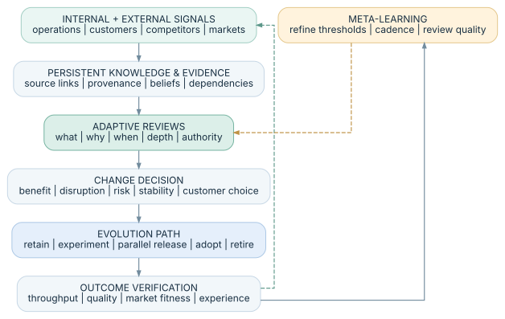
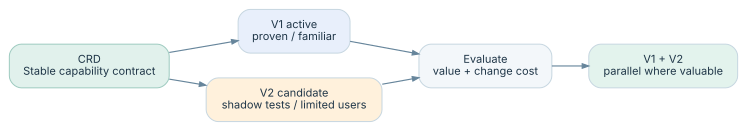
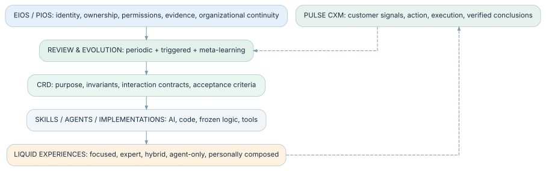

# Executive synthesis

**Liquid Software is not software that changes constantly. It is an architecture in which capabilities and experiences can change when there is sufficient reason, without unnecessarily disrupting what already works.**

A traditional software product bundles capabilities, interface choices, release timing, and commercial packaging into one vendor-defined experience. A traditional organization similarly bundles observation, analysis, decisions, and change into management meetings and fixed planning cycles. AI makes it possible to separate these things. The critical question is not simply *what can now be automated?* It is *what should be reviewed, when, why, at what depth, and how should a justified change be introduced?*

The answer must account for two truths at once:

1. Continuous information processing and learning can improve decisions, lower costs, and detect changing needs earlier.
2. Stability, familiarity, predictable processes, and continuity have positive economic and human value. Forced change can destroy part of the very value an improvement was intended to create.

This paper integrates **six interdependent concepts** developed in the discussion:

- **Layered review and intelligence cycles.** Continuous, daily, weekly, monthly, quarterly, and annual perspectives differ in purpose and depth. Event-triggered reviews supplement rather than abolish them.
- **A self-improving meta-loop.** A separate learning capability evaluates whether reviews, triggers, thresholds, and decisions are effective, including whether the organization changes too much or too little.
- **Governed evolution through parallel versions.** A new implementation can be released alongside an existing one, evaluated, optionally adopted, retained for a subset of users, or retired deliberately.
- **Individual, contextual experiences.** Users should not be forced into the same feature set or interface. Focused, dense, hybrid, and agent-only experiences can share a common capability layer.
- **Capability-based execution.** CRDs define durable capability meaning; Skills and agents orchestrate usage; code, deterministic rules, or compiled reasoning implement particular parts. Implementation can evolve without silently changing requirements.
- **Customer-led value verification.** Pulse CXM contributes the outside-in loop connecting genuine customer signals to coordinated action and conclusions about whether the original customer problem has actually improved.

{width=93%}

**Unifying principle:** *Continuous intelligence. Adaptive evolution. Stable operation and experience.*

The paper distinguishes established practices and third-party claims from the proposed architecture. It is a design thesis and research resource, not a claim that one existing product implements the entire model.

# 1. The underlying problem: valuable capabilities, unwanted change

## 1.1 The vendor's product is not the individual's working environment

The conventional product model serves many people through one product roadmap. New features are added because they serve some customers, improve competitive positioning, satisfy enterprise buyers, or expand the vendor's revenue. Yet the additional capability often arrives in the user interface of everybody else, including people who have no reason to use it. A feature may be valuable in aggregate while being distracting in a particular person's workflow.

In its **2019 Feature Adoption Report**, Pendo analyzed three months of anonymized data across 615 Pendo subscriptions and reported that roughly **80% of features in the average product were rarely or never used**; around 12% of features accounted for 80% of average daily usage volume [R7]. These are aggregate measurements of the products in its sample, not proof that each individual uses only 20% or that 80% of every interface can safely be removed.

The more important architectural question is whether the features that matter to **one** user overlap with those that matter to **another**. They often need not. Consequently, removing the same 80% for everyone would be no better than forcing the same 100% on everyone.

Unused capacity can also be deliberate. A rarely invoked emergency action, advanced diagnostic, or annual reporting function may be valuable despite low frequency. Therefore the right optimization target is **relevance, task success, and realized value**, not maximal feature adoption.

## 1.2 Forced upgrades impose unmeasured costs

A vendor may measure a new interface's speed or adoption but overlook the transition costs borne by users and organizations: relearning spatial routines, loss of familiarity, documentation and training changes, broken automations, increased support requests, disturbed production work, or the effort of navigating unfamiliar settings. Changes can be welcome to some users and harmful to others.

At the organizational level, a parallel effect occurs when operating procedures are constantly redesigned. Even beneficial changes require absorption capacity. People, agents, suppliers, integrations, and customers are all parts of an operating system. **Change has a cost; stability has value.**

## 1.3 The opportunity is separation, not unlimited configurability

Liquid Software separates **capability**, **context**, **interface**, and **evolution decision**. It does not imply a screen that rearranges itself unpredictably whenever a model sees a new pattern. A personalized workspace must be able to stay familiar, remain inspectable, and support user-controlled change.

Existing UX ideas such as progressive disclosure and interface customization already make important contributions [R8, R9]. The broader proposal is to take the separation deeper: capabilities can originate from multiple systems, be used directly by agents, and appear in different compositions without requiring the same vendor-imposed screen, application, or upgrade path.

# 2. Organizational intelligence exists at different timescales and depths

Organizations have long maintained different review rhythms. These are not merely artifacts of human slowness. They create **coordination, commitment, stability, accountability, and appropriately deep deliberation**.

| Perspective | Illustrative cadence | Central question | Typical output |
|:--|:--|:--|:--|
| Continuous | Event-driven | Is the operating state healthy? | Updated state, alerts, permitted corrections |
| Operational | Daily | What needs action now? | Exceptions, priorities, assignments |
| Tactical | Weekly | Where is work accumulating or drifting? | Coordination, dependency management |
| Management | Monthly | Are outcomes and resources developing as intended? | Performance diagnosis, resource changes |
| Strategic | Quarterly | Are assumptions and competitive conditions changing? | Strategic choices, experiments |
| Directional | Annual cycle | Are the mission, portfolio, capabilities, and investments still appropriate? | Commitments, plans, major transitions |

These are **starting patterns, not universal schedules**. A highly volatile market may require some strategic assumptions to be checked daily; an otherwise stable operational process may need only exception-driven review.

The temporal dimension and the **depth of reasoning** are separate. A strategic event can demand immediate attention. An operational issue may be examined only in a monthly review. Fixed calendars remain useful because they provide a predictable opportunity to synthesize, approve, and coordinate decisions. Event triggers add responsiveness where waiting would be costly.

## 2.1 Review layers are not merely a hierarchy of summaries

A daily review may identify a customer support backlog. A monthly review may infer a structural service-capacity problem. A quarterly review may conclude that the value proposition has drifted or that a segment needs a different delivery model. These are different reasoning tasks using overlapping evidence, not three summaries of the same dashboard.

Each review layer should define: **purpose; scope; input evidence; required depth; authority; expected outputs; default cadence; exceptional triggers; and criteria for revisiting its conclusions**.

## 2.2 Persist understanding, not just reports

A recurring monthly review should not repeatedly reconstruct the entire organization from raw transactions and conversations. Current operational state and derivations can be maintained continuously, while preserving the original sources for verification and alternative interpretations.

A useful model distinguishes **evidence**, **propositions**, **beliefs or assessments**, and **decisions**. An assessment should carry its supporting evidence, assumptions, confidence, dependencies, applicable scope, and last-review context. Its validity can be reconsidered when the underlying evidence changes.

This is consistent with the previously developed PIOS/EIOS approach: preserve provenance, distinguish canonical from derived information, and retain a trace from original signals to decisions. Crucially, a previous conclusion is not the same as a permanently correct fact.

# 3. Meta-learning: the loops themselves must be reviewed

Above operational and strategic reviews sits a **meta-learning loop**. It asks whether the organization's own attention, review rhythms, information processing, decision thresholds, and change practices produce good outcomes.

Its questions include:

- Which important external signals are we missing or noticing too late?
- Where do repeated reviews consume resources but rarely change a decision?
- Which decisions are frequently reversed because assumptions were weak?
- Are there profitable opportunities that our approval cadence delays unnecessarily?
- Does excessive change reduce throughput, reliability, or customer confidence?
- Are stable configurations being preserved long after external conditions make them uncompetitive?
- Do experiments produce actionable evidence, or merely more dashboards?

**The goal is not to maximize review frequency.** It is to allocate attention and decision-making effort where they improve long-term outcomes.

## 3.1 Scheduled and triggered reviews complement each other

A default review schedule supplies predictability. A triggering policy accelerates reconsideration when a threshold is crossed, a material dependency becomes invalid, an urgent customer issue recurs, or a market signal threatens strategic assumptions. A trigger should not automatically imply a change: it authorizes or requests **review**, after which the answer may be to retain the current approach.

Triggers themselves should be assessed for false positives, missed events, delay, cost, and consequences. The meta-loop can recommend new frequencies or thresholds, but changes to governance rules still need an appropriate authority.

## 3.2 Learning speed and change speed can be independently optimized

A system may observe continuously, recalculate a reliable metric nightly, deeply reflect quarterly, and deploy a change only when evidence and transition readiness justify it. These distinct speeds are not a contradiction. They are a desirable design property.

# 4. Stability enters the change equation

A common optimization mistake is to compare only the performance of an old and a proposed solution. The actual choice is between **future states including their transition paths**.

A practical, qualitative decision model is:

> **Expected realized improvement** = prospective customer and business benefit - implementation and transition costs - disruption and switching costs - added operational risk - ongoing parallel-support cost.

This is a decision heuristic, not a universal numeric equation. Its value lies in forcing explicit consideration of costs that feature roadmaps and AI optimizers often omit.

## 4.1 Two top-level outcome dimensions

**Internal throughput:** how effectively the organization turns time, capital, skills, information, and other resources into valuable outputs, while maintaining quality and reliability.

**External fitness:** how well those outputs and the organization's capabilities match changing customers, competitors, regulation, technology, and market conditions.

A business may efficiently produce an increasingly irrelevant offering. Another may correctly anticipate market change but disrupt profitable operations through premature restructuring. Successful evolution requires both dimensions and a realistic transition strategy.

## 4.2 Change is not binary

A review can reasonably recommend any of the following:

1. **Keep the current version**, with no new action.
2. **Continue observation** until evidence or relevance improves.
3. **Improve beneath the interface** without changing established user workflows.
4. **Create and test an alternative** without affecting production.
5. **Offer another version in parallel** for a segment, context, or willing user.
6. **Adopt in stages** with measurement and rollback paths.
7. **Retire an older version** only after compatibility, user, legal, and support dependencies have been addressed.

The important design choice is to make these distinct outcomes first-class. "Do nothing for now" may be the correct, actively evaluated result.

## 4.3 Reversibility affects required evidence

A reversible interface layout trial can tolerate more experimentation than a contract change, major organizational restructuring, or irreversible data migration. Expected impact, reversibility, and decision authority should influence the approval gate. High-disruption changes may merit staged pilots, explicit sign-off, stronger evidence, or delayed adoption even when the expected upside is substantial.

# 5. Parallel versions and deliberate retirement

**Build new alongside what works; do not make replacement the default.** Parallel versions are established in software delivery through blue-green deployments, canary releases, feature toggles, and the parallel-change pattern [R10, R11, R12]. Liquid Software generalizes the principle beyond code to interfaces, Skills, agent workflows, operating processes, and, where feasible, business models.

{width=94%}

## 5.1 A version has more than a version number

A robust version record includes: capability or process identity; applicable CRD; implementation type; input/output contracts; supported contexts; dependencies; security scope; validation record; cost and latency; migration compatibility; ownership; lifecycle status; and retirement conditions.

Useful statuses include **experimental**, **candidate**, **active**, **active for a defined cohort**, **legacy-supported**, and **retired**. More than one implementation can legitimately be active at once.

## 5.2 Independence between release and adoption

Publishing a new capability is not the same as forcing a new experience. A provider might make an implementation available while an organization, user, or agent continues using a previous version. The separation only works when contract compatibility, security updates, entitlement, data formats, and support obligations are designed into the system.

Parallelism is not free. Supporting many versions can create a compatibility matrix, maintenance overhead, security exposure, and operational complexity. Retirement should therefore also be evidence-based, not endlessly postponed. Some emergency security, regulatory, or safety changes cannot remain purely optional.

## 5.3 Different realizations can coexist indefinitely

One CRD capability might be implemented through a large model, a smaller model, a deterministic rule engine, conventional code, or a hybrid. An enterprise may prefer determinism for a stable, regulated workflow and model reasoning for genuine exceptions. Another user may prefer a fully conversational experience for the same underlying purpose. Multiple valid implementations are a feature of the architecture, not automatically technical debt.

# 6. Liquid interfaces: personal, contextual, and stable

A user's interface should reflect their work rather than a vendor's full catalog of features. This includes **which capabilities appear**, **how much information is visible**, **which controls are direct**, and **whether an interface is necessary at all**.

## 6.1 Four complementary experience modes

| Mode | Appropriate use | Characteristics |
|:--|:--|:--|
| Focused | Frequent narrow tasks | Few visible controls, low distraction |
| Dense / expert | Multi-variable or high-volume tasks | More simultaneous information, direct actions, keyboard workflows |
| Hybrid / composed | Work spanning multiple domains | Combine panels and capabilities from different providers or usage contexts |
| Agent-primary | Tasks not requiring ongoing manual control | Agent operates capabilities; the human receives decisions, exceptions, and approvals |

No mode is a universal beginner-to-expert progression. A highly capable professional may prefer a simple interface when focused, and a dense one when analyzing. Preferences evolve with expertise, available information, responsibilities, devices, and immediate purpose. Users may prefer stable named workspaces rather than one interface that constantly adapts itself.

## 6.2 Individual feature subsets are different, not merely smaller

One user benefits from schedule planning and recurring tasks; another needs dashboards and advanced filtering; a third primarily uses search and export. The common capability inventory can be large while each personal composition stays deliberately narrow. Removing features globally is therefore not the solution to low aggregate adoption.

## 6.3 Personalized does not mean uncontrolled surveillance or manipulation

Personalization should respect owner-controlled preferences, access permissions, purpose limitation, and the ability to override inferred choices. Usage observations may inform recommendations, but should not silently override an established workspace or create commercial upsell pressure disguised as optimization.

The person should be able to **retain**, **preview**, **accept**, **reject**, **revert**, and **combine** experiences. A useful design default is *suggest, do not impose*, unless an authorized security or critical operational policy requires otherwise.

## 6.4 A stable experience can sit on rapidly evolving capabilities

A provider can improve a capability behind a durable interaction contract while the user's established interface remains unchanged. Conversely, a user can replace or recombine their interface without requiring the provider to rewrite the underlying service. This independence is central to Liquid Software and is supported at the specification level by CRD [R2].

# 7. CRD, Skills, agents, software, and frozen reasoning

The **Capability Requirements Document (CRD)** framework describes the smallest complete, contextually meaningful capability independently of the current technology. Its core includes purpose, boundaries, requirements, interaction contracts, realizations, evidence, and unknowns [R2]. The original Liquid Software resource remains the umbrella for choosing agent-only, software-only, or hybrid execution [R1].

{width=94%}

In this model:

- **CRD** specifies *what must remain true* for a capability, including its contracts and acceptance criteria.
- **Skill** supplies agent-readable instructions and workflows for invoking, composing, or implementing capabilities; it may itself include scripts or tools.
- **Agent** interprets situations, coordinates work, handles novelty and exceptions, and chooses when capabilities are needed.
- **Deterministic implementation** executes explicit rules or algorithms under known conditions.
- **Software, API, MCP, or UI realization** exposes or performs capabilities through the appropriate interface or runtime.
- **Evolution governance** decides when an implementation should be tested, introduced, retained, or retired. It should not be confused with the CRD itself.

A Skill can use several CRD-defined capabilities, and a single capability may have several implementations. Thus neither the CRD nor the Skill needs to become a monolithic software product.

## 7.1 A dedicated Reasoning Compilation Skill

One plausible reusable capability is a **Reasoning Compilation Skill** (or *Crystallization Skill*), whose purpose is to identify repeatable portions of agent reasoning and turn them into explicit, testable implementations.

Its proposed lifecycle is:

1. Inspect the Skill, CRD, operating constraints, examples, and execution evidence.
2. Identify reasoning steps whose inputs, rules, and outputs can be formalized.
3. Generate an implementation using code, a rule engine, or a reasoning-block technology.
4. Validate against the CRD, independent tests, invariants, and adverse cases.
5. Register a **candidate version** with provenance, assumptions, and limitations.
6. Test in shadow or parallel operation; promote only with required approval.
7. Monitor drift, dependency changes, exceptions, and new versions of the capability.

Importantly, such a Skill should have its **own CRD and governance rules**. Automated compilation is a proposed design pattern, not a confirmed capability of a particular vendor.

## 7.2 What can and cannot be frozen

**Good candidates:** repeatable calculations; explicit allocation and routing rules; permission checks derived from authoritative policies; validation of input completeness; stable constraint optimization; and deterministic business-rule execution.

**Partial candidates:** document interpretation followed by rule-based validation; agentic workflow orchestration with deterministic gates; or analytical Skills with stable numeric components and open-ended interpretation.

**Poor candidates:** ambiguous judgment with evolving context; strategic sense-making; unverified assumptions; interpretation of rapidly changing laws without authoritative updates; and personalized advice where the relevant goals are unresolved.

Freezing a decision path does **not** make its assumptions true, its evidence fresh, or its implementation correct. A deterministic program can consistently reproduce the wrong answer. Validation, versioning, source dependencies, and invalidation are mandatory if frozen logic is to be trusted.

## 7.3 MDIL and Optivian illustrate different reuse opportunities

**MDIL Kide and REMAP** present a declared-reasoning and deterministic agent-decision approach. Their published materials emphasize readable rules, auditable decisions, and moving portions of agent control outside generation [R5]. This is relevant to executable reasoning and guarded routing. A commercial product's supported interfaces, proof level, openness, and implementation details must be evaluated directly; it would be incorrect to assume automatic CRD compliance or generalized correctness.

**Optivian** presents an adjacent but distinct optimization: process source interactions when they arrive, keep an updated structured view, and retrieve focused evidence rather than repeatedly reconstructing the same context from raw CRM, email, and meeting records. In a vendor-reported example, billable tokens declined from **933,294 to 158,691** (roughly **5.9x** less), with estimated per-run cost declining from **$2.96 to $0.53** [R6]. This is a reported customer example, not a universal independently measured benchmark.

These approaches address different avoidable repetitions:

| Avoidable repetition | Architectural response |
|:--|:--|
| Re-reading and reconstructing the same data | Continuously maintained, provenance-linked knowledge and derivations |
| Re-solving the same formalizable logic | Validated reusable implementation or compiled reasoning |
| Re-evaluating the same governance question without changed evidence | Persisted assessments with triggers and scheduled reconsideration |
| Rebuilding the same interface for every provider or task | Reusable capabilities and individual experience composition |

# 8. Pulse CXM: outside-in intelligence and verified improvement

**Pulse CXM** is an AI-native customer experience management approach associated with Digiole, designed to turn customer interaction signals into coordinated cross-team action and verified improvement [R3]. It should not become a generic replacement for all organizational intelligence. Its distinctive role is to connect **customer-lived experience** with the organization's ability to change and confirm value.

The established four-part operating model is:

1. **Pulse:** collect source-linked signals, interactions, contextual information, recurring issues, and emerging patterns.
2. **Actions:** identify opportunities and problems; prioritize them; assign responsibility; account for dependencies and organizational objectives.
3. **Execution:** carry out cross-team work, experiments, changes, and phased adoption.
4. **Conclusions:** verify what happened, whether the original issue recurred, whether outcomes improved, and what management should conclude.

**Completion is not resolution.** An issue is not resolved simply because a task was closed, a feature shipped, or a new interface released. It is resolved to the extent that the customer problem or opportunity changes in the intended way.

## 8.1 Listening by helping

Talking Products and Talking Venues provide illustrative customer interaction sources: contextual, multilingual, help-first conversations that create a useful experience for the customer while generating authentic signals for the organization [R4]. Pulse CXM can also use support interactions, reviews, sales, product telemetry, customer conversations, and other legitimate sources.

The important shift is that customer insight becomes a **continuous byproduct of service**, not only a survey campaign. Context and appropriate consent matter: the mere availability of a signal does not justify unlimited reuse of personal data.

## 8.2 Pulse CXM feeds EIOS without swallowing EIOS

**EIOS** governs the organization's broader objectives, resource choices, internal and external performance, knowledge continuity, and review architecture. **Pulse CXM** supplies an essential customer-centered learning and execution stream. Organization-level DNA (mission, strategy, principles), Growth (OKRs, KPIs, teams, performance), and Settings (sources, reporting, configuration) help contextualize Pulse decisions, without redefining the four operational stages.

Pulse CXM can influence reviews at several horizons: immediate service failures, recurring monthly friction, changing segment expectations, or a strategic shift in the market. Equally, a strategic EIOS review may authorize experiments in the customer experience, which Pulse CXM later verifies.

## 8.3 Pulse can monitor unwanted change as well as insufficient change

A particularly powerful extension is to treat *disruption caused by improvements* as a customer-experience signal. Pulse CXM can track whether a redesigned interface creates new confusion, whether expert users lose essential shortcuts, whether a forced change generates support traffic, or whether a minority segment gains substantial value from an optional alternative.

This makes Pulse CXM relevant not only to **what to improve** but also to **how to release, adopt, and retire** improvements. It can compare experience cohorts without presuming that the newest version should prevail.

# 9. An integrated decision and execution framework

A practical architecture benefits from explicit, versioned objects rather than keeping everything inside prompts, meetings, or dashboards.

| Object | Purpose / essential fields |
|:--|:--|
| Signal | Source, time, provenance, scope, reliability, relevance, consent/permissions |
| Review policy | Purpose, depth, cadence, triggers, authority, required evidence |
| Review record | Evidence considered, hypotheses, conclusion, uncertainty, next review |
| Change proposal | Desired outcome, affected groups, alternatives, benefit, disruption, risk |
| CRD | Capability meaning, boundaries, contracts, rules, acceptance criteria |
| Implementation version | Realization, dependencies, status, test evidence, compatibility |
| Experience composition | Individual/context preference, visible capabilities, layout, active versions |
| Experiment / rollout | Cohort, exposure, guardrails, observation window, stop/rollback rules |
| Outcome evidence | Actual effects, unintended consequences, recurrence, decision to retain or revise |

These are **proposed logical objects**, not a mandate for a particular database schema. They can be represented through canonical and derived objects in PIOS/EIOS with rights and provenance appropriate to each owner.

## 9.1 The decision sequence

For each candidate improvement, the system should be able to answer:

**Check:** What triggered the review? Which evidence is new?  
**Why:** Which internal-throughput or external-fitness outcome matters?  
**What:** What capability, interface, process, assumption, or policy might change?  
**Who:** Who benefits, who is disrupted, and who has authority?  
**How:** Retain, adjust, experiment, parallel release, opt-in, migrate, or retire?  
**When:** Immediate, scheduled, deferred, conditional, or user-chosen?  
**Verify:** What measurements would indicate success, non-improvement, or harm?  
**Learn:** Should the review trigger, decision rule, or release strategy itself be revised?

## 9.2 Governance and fallback

The framework should never let a predictive suggestion silently become an authorized policy. Distinguish **observed fact**, **derived inference**, **proposed change**, **approved decision**, and **deployed implementation**. Preserve who or what made the decision and under which authority.

For user interfaces, personal preferences and overrides are part of the authority model. For organizational processes, authorization can depend on financial exposure, legal consequences, customer impact, and rollback feasibility. For frozen logic, changed inputs or assumptions may trigger revalidation rather than blind reuse.

# 10. Worked scenarios

## Scenario A: A software interface users experience differently

**Signals.** Pulse CXM detects recurring complaints that a business interface is distracting. Usage data reveals that a separate expert cohort frequently opens detailed panels and wants more simultaneous information. The two needs are not contradictory.

**Review.** The product capability inventory and CRDs show that underlying capabilities can remain shared. A monthly CX review proposes two interface compositions rather than one forced redesign. A strategic review asks whether these cohorts represent durable market segments.

**Evolution.** The existing UI remains active. A focused workspace and an expert workspace are tested with voluntary cohorts. A hybrid composition is available for tasks combining the two perspectives. Changes can be previewed and reverted.

**Validation.** Evaluate time-to-complete, error rates, task success, unsolicited complaints, continuity, accessibility, and whether the same person uses different modes by context. Pulse Conclusions tests whether the friction actually declines; usage alone does not establish that.

**Resulting principle.** One shared capability layer can support several legitimate experiences; adoption is contextual and should not require unnecessary migration.

## Scenario B: A recurring operational workflow with frozen reasoning

**Signals.** EIOS identifies a repeatable procurement process with expensive agent reasoning, intermittent mistakes, and a stable set of rules.

**Review and specification.** A CRD clarifies required checks, exception handling, approvals, and outputs. A Reasoning Compilation Skill identifies steps suitable for deterministic execution. The original model-driven implementation remains available for unresolved exceptions.

**Parallel validation.** The new implementation runs in shadow mode using real or representative inputs without making duplicate side effects. Nightly tests verify constraints, policy changes, output quality, and dependency versions. The system compares latency, cost, accuracy, failure modes, and auditability.

**Adoption.** A permitted subset of requests moves to the new implementation. The older execution path continues for cases outside the validated scope and as a rollback option. Retirement occurs only when coverage and support economics justify it.

**Resulting principle.** Freeze *formalizable reasoning*, not the organization's entire capacity to think or the truth of changing evidence.

## Scenario C: A market shift before the next quarterly review

**Signals.** A competitor introduces a business model that changes customer expectations. Customer conversations, lost deals, and market data begin to align.

**Review.** An event-triggered strategic review starts ahead of the scheduled quarter. The review tests competing explanations, considers the effect on market position, and assesses whether the signal is temporary or structural.

**Evolution.** The organization pilots a new offer for one customer segment while maintaining the current business for others. A new capability or pricing process can operate in parallel; the transition is not a forced replacement.

**Validation.** Measure retention, margins, conversion, delivery capacity, and operational disruption, then compare the evidence at the next scheduled strategic review. The meta-loop considers whether trigger sensitivity was appropriate.

**Resulting principle.** Review can accelerate without requiring premature strategic change.

## Scenario D: Personal Core and organizational Core

The pattern has a natural owner boundary. **PIOS** can maintain an individual's preferred workspaces, task rhythms, permissions, trusted facts, and personally derived knowledge. **EIOS** can maintain organizational policies, capability versions, review records, and cross-team outcomes. Neither should assume unrestricted access to the other's context.

A person can use an EIOS-backed capability in a personally composed interface without surrendering personal history or UI preferences to the organization. Sharing occurs through authorized interfaces, and organizational agents do not automatically gain access to an individual's Core.

# 11. Measurement and experimental research agenda

No single metric captures this architecture's success. A useful evaluation portfolio includes:

| Dimension | Candidate measures |
|:--|:--|
| Throughput | Valuable outcomes per unit of time/resource; process lead time; queue time |
| Quality | Task success, defect rate, policy compliance, customer-reported resolution |
| Market fitness | Retention, win/loss factors, segment adoption, relevance of offering |
| Experience stability | Forced retraining, workflow interruption, user rejection, complaints after change |
| Change efficiency | Time to validate, deployment reversal, adoption by choice, value realized vs forecast |
| Reasoning efficiency | Total inference and processing cost, latency, deterministic coverage, exceptions |
| Learning-system quality | Missed signals, false triggers, review cost, decision reversals, time-to-correction |
| Portfolio health | Parallel-version support burden, security exposure, legacy dependencies |

A practical first test should compare a **baseline** (single forced UI or one model-driven capability) with a **parallel, user-selectable or deterministically optimized alternative**. Record pre-existing task differences, cohort effects, transition costs, and failures. Avoid declaring success solely from token savings or interface adoption. Evaluate both sustained value and disruption.

## 11.1 Research questions still open

- How should different review layers share evidence without hard-wiring a rigid reporting hierarchy?
- What thresholds justify a triggered strategic review rather than monitoring alone?
- How do we quantify the positive value of stable workflows and familiar interfaces?
- When does supporting multiple active versions cost more than the personalization benefit?
- What is the smallest interoperable metadata standard for an experience composition?
- Can frozen reasoning remain portable across runtimes and providers, with verifiable semantics?
- How should an AI-native organization distinguish reversible experimentation from changes that require accountable human approval?
- Which signals show that customer experience problems have truly disappeared, rather than merely changing form?

# 12. Design principles and scope boundaries

1. **Optimize realized outcomes, not change frequency.** The objective combines internal throughput, external fitness, and transition effects.
2. **Separate sensing, understanding, deciding, adopting, and verifying.** Different rhythms and authorities are appropriate.
3. **Give stability explicit value.** Familiarity and production continuity belong in the decision, not as afterthoughts.
4. **Use fixed cycles as defaults and triggers as exceptions.** The meta-loop learns whether both are effective.
5. **Preserve canonical evidence and traceable derivations.** Previously generated knowledge can be reused without becoming unquestioned truth.
6. **Specify capabilities independently of implementations.** CRD meaning should outlive a particular Skill, model, UI, or vendor.
7. **Compile only what can be formally checked.** Determinism is not a substitute for correctness or fresh evidence.
8. **Separate release from adoption.** A new version need not replace an older one for everybody.
9. **Support multiple legitimate experiences.** Individual, task, and context preferences are not merely maturity levels.
10. **Treat retirement as a decision.** Parallel versions have maintenance costs and cannot proliferate indefinitely.
11. **Measure customer resolution, not task completion.** Pulse CXM connects changes to lived outcomes.
12. **Keep authority, consent, and ownership explicit.** Personalized interfaces and organizational optimizers should not become instruments of forced change.

**Non-goals:** an interface that continually rearranges itself; automatic production changes from unreviewed agent conclusions; a requirement to turn every function into a CRD; a belief that all reasoning can be frozen; an assumption that all users should eventually converge on the same expert UI; and a claim that any single vendor currently offers this complete architecture.

# 13. Relationship to the wider Liquid Software resource

The umbrella Liquid Software concept asks whether a task needs software at all, whether an agent can perform it directly, and whether the appropriate solution is a dynamic combination of agents, existing software, newly generated software, and user-facing interfaces [R1].

This companion paper adds **the temporal and governance dimension**:

> What should the system check, why, how deeply, and when? If evidence supports a change, how should it be developed, tested, introduced, adopted, or retired while preserving what already works?

Its distinct contribution is to unite **organizational review cycles**, **stability-aware change economics**, **parallel implementation and UX versioning**, **CRD-guided validation**, **reusable reasoning**, and **customer-led outcome verification**. These principles are relevant beyond any particular PIOS/EIOS instance or Pulse CXM deployment, while those systems provide concrete application contexts.

The architecture therefore links three independent rates: **the rate of sensing**, **the rate of learning**, and **the rate of change**. Liquid Software seeks to improve each without assuming they should be synchronized.

# References and further reading

**Primary project resources**

- **[R1] Liquid Software.** Concept umbrella and related resources by Valto Loikkanen. <https://valto.github.io/liquid/>. *Link supplied as the project home; content was not retrievable through the research browser during preparation.*
- **[R2] Capability Requirements Document (CRD) Framework.** Specification, capability MLE, interaction contracts, realizations, and authoring resources. <https://valto.github.io/crd/>.
- **[R3] Pulse CXM.** AI-native customer experience management, customer signals to coordinated work and verified improvement. <https://www.pulsecxm.com/>.
- **[R4] Talking Products and Venues.** Background on the help-first interaction and customer-signal approach. <https://valto.github.io/projects/talking-products-venues.html>.
- **[R13] PIOS and Personal Core Infrastructure.** Owner-controlled context and personal AI-system architecture. <https://valto.github.io/projects/pios-personal-core-infrastructure.html>.

**Technology examples (vendor descriptions; claims require independent validation)**

- **[R5] MDIL.** Kide, declared reasoning, REMAP, SDK and audit-oriented agent control. <https://mdil.ai/>. See also <https://code.mdil.ai/connect> and its system-card reference at <https://review.mdil.ai/>.
- **[R6] Optivian.** *The hidden cost of connecting AI straight to your sales stack*. Vendor-reported comparison of repeated raw-data reconstruction against a maintained deal-intelligence context. <https://optivian.ai/insights/hidden-cost-ai-sales-stack/>.

**Empirical and established design / delivery practices**

- **[R7] Pendo (2019).** *The 2019 Feature Adoption Report*. Aggregate usage research across 615 Pendo subscriptions. <https://www.pendo.io/resources/the-2019-feature-adoption-report/>.
- **[R8] Nielsen Norman Group.** *Progressive Disclosure*. <https://www.nngroup.com/articles/progressive-disclosure/>.
- **[R9] Nielsen Norman Group.** *Customization Features* research report and related guidance. <https://www.nngroup.com/reports/customization-features/>.
- **[R10] Martin Fowler.** *Parallel Change*. <https://martinfowler.com/bliki/ParallelChange.html>.
- **[R11] Martin Fowler.** *Feature Toggles (aka Feature Flags)*. <https://martinfowler.com/articles/feature-toggles.html>.
- **[R12] Google Cloud.** *Use a canary deployment strategy*. <https://docs.cloud.google.com/deploy/docs/deployment-strategies/canary>.
- **[R14] Nielsen Norman Group.** *8 Design Guidelines for Complex Applications*. <https://www.nngroup.com/articles/complex-application-design/>.

**Origin and evidence note.** This is a synthesis of the 28 November 2026 Liquid Software/PIOS/EIOS/CRD/Pulse CXM discussion, building on the named project concepts. Examples, architecture, lifecycle suggestions, and decision heuristics are **proposals** unless otherwise identified. Pendo figures are historical aggregate research; Optivian and MDIL technical results are their own published descriptions. Reference links are supplied for readers to investigate specific claims and underlying frameworks. The document is an independently reusable conceptual companion resource, not a vendor endorsement.
